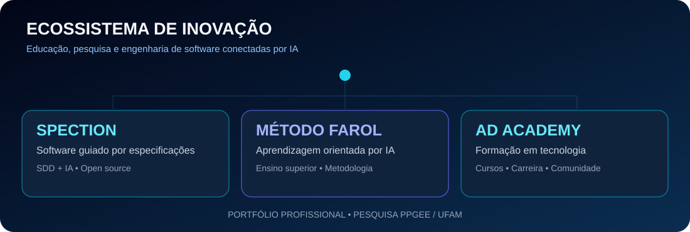

  <a href="#sobre-mim">Sobre mim</a> •
  <a href="#tecnologias">Tecnologias</a> •
  <a href="#estatisticas">Estatísticas</a> •
  <a href="#contribuicoes">Contribuições</a> •
  <a href="#projetos">Projetos</a>

&nbsp;&nbsp;&nbsp;

&nbsp;&nbsp;&nbsp;

&nbsp;&nbsp;&nbsp;

  
  
  
  

<table>
<tr>
<td valign="middle" width="70%">

Bem-vindo ao meu GitHub! Sou <strong>Alexsand F. de Souza</strong>, Professor Universitário e Desenvolvedor Full-Stack com mais de 14 anos de experiência em tecnologia.

Atualmente cursando <strong>Mestrado em Engenharia Elétrica</strong> pelo Programa de Pós-Graduação em Engenharia Elétrica - PPGEE da Universidade Federal do Amazonas - UFAM, com pesquisas em <strong>Otimização Não Linear</strong>.

Trabalho como docente no <strong>Centro Universitário CEUNI-FAMETRO</strong> e atuo como mentor de carreiras em tecnologia e especialista em cibersegurança e redes de computadores.

</td>
<td align="center" valign="middle" width="30%">

</td>
</tr>
</table>

---

  <!-- GIFs selecionados da coleção Cool GIFs For GitHub, de Anmol Baranwal (MIT). -->
  &nbsp;
  &nbsp;
  &nbsp;
  

## 🚀 Minhas Ferramentas e Tecnologias ⚙️

> Tecnologias com as quais trabalhei e tenho interesse

  
   
  
   
  

---

### 📊 Estatísticas do GitHub

  <table border="0">
    <tr>
      <td width="50%" align="center">
        <picture>
          <source media="(prefers-color-scheme: dark)" srcset="https://github-readme-stats-salesp07.vercel.app/api?username=alexsandsouza&show_icons=true&theme=github_dark&hide_border=false&border_radius=12&border_color=30363d&locale=pt-br&include_all_commits=true&count_private=true&cache_seconds=1800" />
          <source media="(prefers-color-scheme: light)" srcset="https://github-readme-stats-salesp07.vercel.app/api?username=alexsandsouza&show_icons=true&theme=buefy&hide_border=false&border_radius=12&border_color=dde3ee&locale=pt-br&include_all_commits=true&count_private=true&icon_color=7c6ffa&title_color=3b3f8c&text_color=374151&cache_seconds=1800" />
          
        </picture>
      </td>
      <td width="50%" align="center">
        <picture>
          <source media="(prefers-color-scheme: dark)" srcset="https://github-readme-stats-salesp07.vercel.app/api/top-langs/?username=alexsandsouza&layout=compact&theme=github_dark&hide_border=false&border_radius=12&border_color=30363d&locale=pt-br&langs_count=6&cache_seconds=1800" />
          <source media="(prefers-color-scheme: light)" srcset="https://github-readme-stats-salesp07.vercel.app/api/top-langs/?username=alexsandsouza&layout=compact&theme=buefy&hide_border=false&border_radius=12&border_color=dde3ee&locale=pt-br&langs_count=6&title_color=3b3f8c&text_color=374151&cache_seconds=1800" />
          
        </picture>
      </td>
    </tr>
  </table>
   
  <picture>
    <source media="(prefers-color-scheme: dark)" srcset="https://streak-stats.demolab.com?user=alexsandsouza&theme=github-dark-blue&hide_border=false&border_radius=12&locale=pt_BR&ring=7c6ffa&fire=6366f1&cache_seconds=1800" />
    <source media="(prefers-color-scheme: light)" srcset="https://streak-stats.demolab.com?user=alexsandsouza&theme=buefy&hide_border=false&border_radius=12&locale=pt_BR&ring=7c6ffa&fire=6366f1&currStreakNum=3b3f8c&sideNums=374151&currStreakLabel=7c6ffa&sideLabels=374151&dates=6b7280&cache_seconds=1800" />
    
  </picture>

---

### 🐍 Contribuições em movimento

  <picture>
    <source media="(prefers-color-scheme: dark)" srcset="https://raw.githubusercontent.com/alexsandsouza/alexsandsouza/output/github-contribution-grid-snake.svg"/>
    <source media="(prefers-color-scheme: light)" srcset="https://raw.githubusercontent.com/alexsandsouza/alexsandsouza/output/github-contribution-grid-snake-light.svg"/>
    
  </picture>

Atualização automática diária pelo GitHub Actions. A animação aparecerá após a primeira execução bem-sucedida do workflow.

## ✨ Projetos em destaque

Projetos que conectam educação, inteligência artificial, pesquisa e engenharia de software.

<table>
<tr>
<td width="50%" valign="top">
<h3>🧭 SPECTION</h3>

Framework open source para desenvolvimento de software orientado por especificações e inteligência artificial.

<a href="https://github.com/alexsandsouza/spection"><strong>Explorar repositório</strong></a>
</td>
<td width="50%" valign="top">
<h3>💡 Método FAROL</h3>

Formação e aprendizagem com recursos orientados por IA para o ensino superior.

<a href="https://alexsandsouza.github.io/metodofarol/"><strong>Conhecer o método</strong></a> · <a href="https://github.com/alexsandsouza/metodofarol">Código</a>
</td>
</tr>
<tr>
<td width="50%" valign="top">
<h3>🎓 AD Academy</h3>

Plataforma educacional para cursos de graduação, pós-graduação e extensão em tecnologia.

<a href="https://adacademynet.vercel.app"><strong>Ver online</strong></a> · <a href="https://github.com/alexsandsouza/adacademynet">Código</a>
</td>
<td width="50%" valign="top">
<h3>🌐 Portfólio &amp; Hub</h3>

Portal acadêmico e profissional com palestras, mentoria em IA e trajetória técnica.

<a href="https://alexsanderfarias.vercel.app"><strong>Ver online</strong></a> · <a href="https://github.com/alexsandsouza/portfolio">Código</a>
</td>
</tr>
<tr>
<td colspan="2" valign="top">
<h3>🔬 Otimização PPGEE</h3>

Pesquisas em Otimização Não Linear pelo Mestrado em Engenharia Elétrica na UFAM.

<a href="https://github.com/alexsandsouza/optimization2026"><strong>Consultar código UFAM</strong></a>
</td>
</tr>
</table>

Créditos das animações de terceiros: <a href="https://github.com/Anmol-Baranwal/Cool-GIFs-For-GitHub">Cool GIFs For GitHub</a>, coleção de Anmol Baranwal. <a href="https://github.com/Anmol-Baranwal/Cool-GIFs-For-GitHub/blob/main/LICENSE">Licença MIT e aviso de copyright</a>. Os GIFs são carregados dos URLs indicados no repositório de referência.

---

  
<i>"A tecnologia move o mundo, mas a educação transforma as pessoas que constroem essa tecnologia."</i> 🎓💻✨

